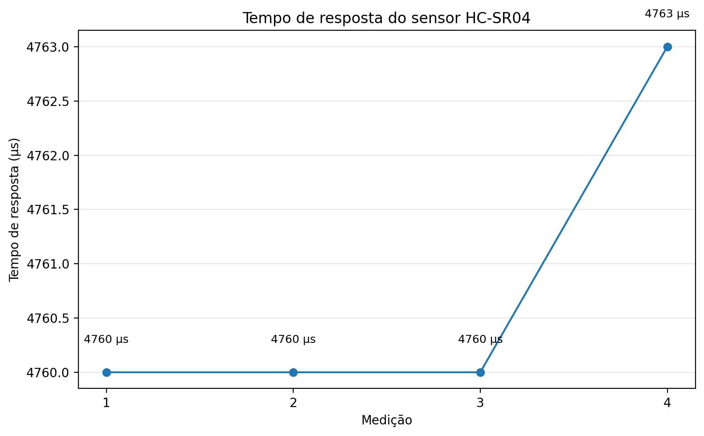
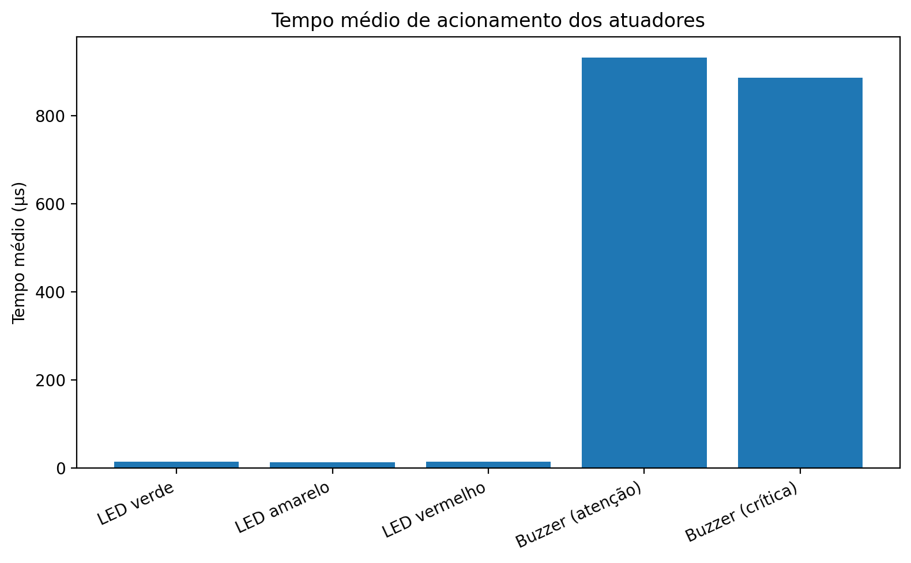
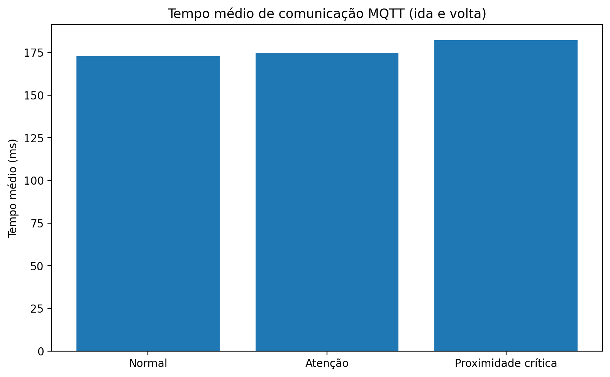

# Resultados dos testes

O protótipo foi avaliado em três condições de proximidade: normal, atenção e proximidade crítica.

## Testes funcionais

| Condição | Distância aproximada | LED | Buzzer |
|---|---:|---|---|
| Normal | 153 cm | Verde | Desligado |
| Atenção | 82 cm | Amarelo | Intermitente |
| Proximidade crítica | 31,4 cm | Vermelho | Intermitente mais frequente |

## Sensor HC-SR04

Foram realizadas quatro medições consecutivas do pulso ECHO, mantendo o obstáculo a aproximadamente 82 cm.

| Medição | Duração |
|---|---:|
| 1 | 4760 µs |
| 2 | 4760 µs |
| 3 | 4760 µs |
| 4 | 4763 µs |
| **Média** | **4760,75 µs** |

O intervalo medido corresponde à duração do pulso ECHO utilizada pelo software para calcular a distância entre o sensor e o obstáculo.

## Atuadores

| Atuador / condição | Medição 1 | Medição 2 | Medição 3 | Medição 4 | Média |
|---|---:|---:|---:|---:|---:|
| LED verde – Normal | 14 µs | 14 µs | 14 µs | 14 µs | 14 µs |
| LED amarelo – Atenção | 13 µs | 13 µs | 13 µs | 13 µs | 13 µs |
| LED vermelho – Proximidade crítica | 14 µs | 14 µs | 14 µs | 14 µs | 14 µs |
| Buzzer – Atenção | 932 µs | 932 µs | 932 µs | 932 µs | 932 µs |
| Buzzer – Proximidade crítica | 886 µs | 886 µs | 886 µs | 886 µs | 886 µs |

Os valores representam o tempo de execução dos comandos de acionamento no ambiente de simulação.

## Comunicação MQTT

Para avaliação da comunicação MQTT foi utilizado o tópico auxiliar:

`projeto/proximidade/eco`

O ESP32 publicou uma mensagem e permaneceu inscrito no mesmo tópico, permitindo medir o tempo de ida e volta da comunicação pelo broker.

| Condição | Medição 1 | Medição 2 | Medição 3 | Medição 4 | Média |
|---|---:|---:|---:|---:|---:|
| Normal | 180,840 ms | 148,353 ms | 181,146 ms | 180,418 ms | 172,69 ms |
| Atenção | 183,421 ms | 182,619 ms | 183,421 ms | 149,804 ms | 174,82 ms |
| Proximidade crítica | 187,321 ms | 201,806 ms | 170,525 ms | 169,122 ms | 182,19 ms |

As mensagens de distância e estado também foram recebidas por um cliente MQTTX conectado ao broker público HiveMQ.

## Gráficos dos resultados

### Sensor HC-SR04

### Atuadores

### Comunicação MQTT

## Dados consolidados

Os dados consolidados utilizados na análise também estão disponíveis em:

[Resultados consolidados em CSV](Resultados_consolidados_do_prot_tipo.csv)
